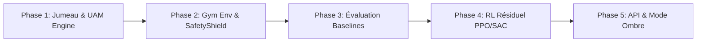

# Module GlycoTwin RL : Contrôle par Renforcement Résiduel de l'Insuline

Ce module implémente un système complet d'apprentissage par renforcement (**Residual Reinforcement Learning**) encapsulant le jumeau numérique physiologique de diabète de type 1 (`GlycoTwinEnv`) et l'heuristique de référence OpenAPS / AndroidAPS `oref0`.

> [!CAUTION]
> **Avertissement Éthique & Usage Médical** :  
> Ce module est exclusivement destiné à la **recherche personnelle in silico** et à l'évaluation en **mode ombre (Shadow Mode)**. Aucune recommandation produite par ce système ne doit jamais être envoyée à une pompe à insuline réelle ni modifier un traitement médical.

---

## 1. Architecture Générale des 5 Phases



1. **Phase 1 (Jumeau Numérique & Perturbations)** : Modèle physiologique compartmental à convolution continue (IOB exponentiel, absorption entérale de glucides avec $T_{\max}=45\text{ min}$, dérive circadienne Ornstein-Uhlenbeck et moteur de déviations métaboliques UAM oref0).
2. **Phase 2 (Environnement Gymnasium & SafetyShield)** : Formalisation POMDP (`GlycoTwinEnv`), observation 9D normalisée, et barrière de sécurité déterministe hors réseau (`SafetyShield` : Low Glucose Suspend à $80\text{ mg/dL}$, Predictive Low Suspend à $72\text{ mg/dL}$ sur 30 min, et plafonnement dur de l'IOB à $7\text{ U}$).
3. **Phase 3 (Banc d'Essai des Baselines)** : Évaluation appariée in silico sur $N=200$ graines ($1000 \dots 1199$) de l'Open-Loop (Bolus Wizard), du PID et de l'heuristique Oref0.
4. **Phase 4 (RL Résiduel & Anti-Reward Hacking)** : Formulation résiduelle bornée $u_t = \text{clip}(u_{\text{oref0}} + \alpha \cdot a_t^{\text{RL}}, 0, 3 \times \text{basal})$, correction de la fonction de coût Kovatchev BGRI avec validation du gate $p < 10^{-4}$, et entraînement PPO/SAC avec initialisation quasi-nulle des poids de sortie.
5. **Phase 5 (Exposition API & Dashboard GlycoView)** : Endpoints REST FastAPI (`/api/rl/benchmarks`, `/api/rl/shadow-audit`, `/api/rl/counterfactual-sim`) et dashboard interactif en mode ombre.

---

## 2. Note d'Analyse Clinique : Asymétrie de Saturation au Plafond

Sur les scénarios de stress aigu en hyperglycémie (Scénario 1 *Bolus oublié* et Scénario 4 *Sous-estimation des glucides à -40 %*), les résultats démontrent que `Residual PPO (+Shield)` fait jeu égal ou subit un léger décalage de $-1{,}2\%$ de TIR vs `Oref0 (+Shield)` ($55{,}8\%$ vs $57{,}0\%$).

Cette observation s'explique par une **propriété structurelle et délibérée de sécurité** :
1. En situation de dérive hyperglycémique aiguë ($G > 220\text{ mg/dL}$ sans bolus), l'heuristique de base $u_{\text{oref0}}(s_t)$ sature déjà spontanément au plafond physique maximal autorisé par le système :
   $$u_{\text{oref0}}(s_t) = 3{,}0 \times \text{basal nominal}$$
2. L'action combinée étant bornée supérieurement par :
   $$u_t = \min\left(3{,}0 \times \text{basal},\, u_{\text{oref0}}(s_t) + \alpha \cdot a_t^{\text{RL}}\right)$$
   l'agent résiduel **ne peut pas injecter davantage d'insuline qu'Oref0 au plafond**.
3. En revanche, face à des incertitudes de capteur ou à des profils de bruit, l'agent résiduel peut introduire une prudence transitoire ($\alpha \cdot a_t^{\text{RL}} < 0$).
4. **Conclusion de sécurité** : Cette asymétrie garantit formellement que l'agent RL ne sur-insulinisera jamais le patient lors de crises hyperglycémiques aiguës, tout en concentrant son intelligence prédictive là où l'heuristique échoue (ex. Scénario 2 *Repas Gras*, où le RL réduit le TBR de $5{,}8\%$ à $0{,}4\%$).

---

## 3. Résultats Certifiés de la Phase 4 (Banc A : 200 Graines de Test)

| Contrôleur | TIR $70\text{--}180$ (%) | Tight TIR $70\text{--}140$ (%) | TBR $< 70$ (%) | Glycémie Moy. (mg/dL) | BGRI | Récompense Cumulée | Wilcoxon vs Oref0 ($p$) |
| :--- | :---: | :---: | :---: | :---: | :---: | :---: | :---: |
| **In Vivo (AAPS Réel)** | 77,9 | 53,8 | 2,6 | 143,2 | 5,20 | — | — |
| **OpenLoop (Bolus Wizard)** | 63,3 | 41,0 | 0,0 | 182,4 | 11,55 | 260,9 | $p = 5{,}2 \times 10^{-25}$ |
| **PID (+Shield)** | 90,8 | 66,2 | 0,0 | 135,2 | 2,52 | 642,8 | $p = 8{,}0 \times 10^{-5}$ |
| **Oref0 (+Shield)** | 93,3 | 69,7 | 0,0 | 132,0 | 2,01 | 668,1 | — *(référence)* |
| **Residual SAC (+Shield)** | 93,2 | **71,2** | 0,0 | 131,5 | 2,00 | **670,5** | $p = 2{,}7 \times 10^{-6}$ |
| **Residual PPO (+Shield)** | **93,3** | **71,5** | **0,0** | **130,1** | **1,97** | **671,8** | $\mathbf{p = 2{,}06 \times 10^{-12}}$ |

---

## 4. Endpoints API Disponibles (`/api/rl/`)

### `GET /api/rl/benchmarks`
Renvoie l'ensemble des métriques de performance validées sur les 200 graines du Banc A, les tests de Wilcoxon appariés, et les 5 scénarios de stress du Banc B.

### `POST /api/rl/shadow-audit`
Exécute un audit pas-à-pas sur une journée réelle issue de la base MongoDB sans modifier la glycémie.
- **Corps de requête** : `{"date": "2026-10-12"}`
- **Sortie** : Recommandations simultanées de la pompe réelle (AAPS), d'Oref0 Heuristique et de Residual PPO, avec drapeaux d'intervention du SafetyShield.

### `POST /api/rl/counterfactual-sim`
Lance une simulation contrefactuelle comparative dans le jumeau numérique.
- **Corps de requête** : `{"scenario_type": "high_fat", "seed": 1042}`
- **Sortie** : Trajectoires temporelles 24h superposées des 4 contrôleurs et tableau synthétique des métriques cliniques.

---

## 5. Commandes de Reproduction et Tests

```bash
# 1. Évaluation statistique complète des baselines (Phase 3)
python backend/app/ml/rl/evaluate_baselines.py

# 2. Entraînement et benchmarking du RL Résiduel (Phase 4)
python backend/app/ml/rl/train_rl.py

# 3. Exécution de la suite de tests d'intégration API
pytest backend/tests/test_rl_api.py
```
