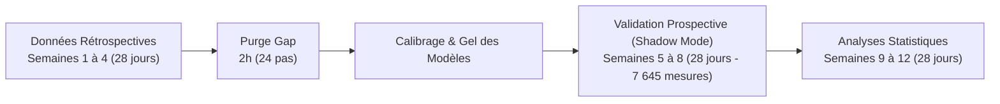

# Développement et Validation Préliminaire d'un Jumeau Numérique Glycémique Hybride Personnalisé chez un Patient Diabétique de Type 1 sous Système d'Administration Automatisée d'Insuline (AndroidAPS) : Étude Pilote N-of-1

**Titre court :** Jumeau Numérique Glycémique sous AndroidAPS (AAPS-DT Pilot)  
**Titre anglais :** *Development and Preliminary Validation of a Personalized Hybrid Glycemic Digital Twin in a Type 1 Diabetes Patient Using Automated Insulin Delivery (AndroidAPS): A Pilot N-of-1 Clinical Study*

---

### Auteurs & Affiliations
* **Ahmed DANY** $^{1, 2}$ *(Ingénieur Concepteur, Patient-Partenaire)*
* **Médecin Commandant Lhoussaine ABAINOU** $^{2, 3}$ *(Investigateur Principal, Spécialiste en Endocrinologie, Diabétologie et Maladies Métaboliques)*

1. *Projet de Recherche GlycoView & Jumeau Numérique Diabète, Agadir, Maroc*
2. *Hôpital Militaire Oued Eddahab (HMOE), Agadir, Maroc*
3. *Service d'Endocrinologie, Diabétologie et Maladies Métaboliques, Hôpital Militaire Oued Eddahab, Agadir, Maroc*

**Auteur correspondant :** Médecin Commandant Lhoussaine Abainou, Service d'Endocrinologie, Diabétologie et Maladies Métaboliques, Hôpital Militaire Oued Eddahab, Agadir, Maroc.  
**Identifiant Protocole :** AAPS-DT Pilot | Version 1.0  
**Calendrier de l'étude (12 semaines / 84 jours) :** 
* *15 juin 2026 :* Approbation institutionnelle du protocole et recueil du consentement éclairé ;
* *1er juillet – 28 juillet 2026 (Semaines 1 à 4, 28 jours) :* Recueil des données historiques et calibrage initial des modèles ;
* *29 juillet – 25 août 2026 (Semaines 5 à 8, 28 jours) :* Phase de validation prospective continue en mode silencieux (*shadow mode*) ;
* *26 août – 22 septembre 2026 (Semaines 9 à 12, 28 jours) :* Contrôle de qualité des données, clôture de la base (*database lock*) et analyses statistiques ;
* *12 octobre 2026 :* Finalisation du rapport de synthèse du protocole (version 1.0).

**Cible de soumission :** *Journal of Diabetes Science and Technology (JDST)* / *Diabetes Technology & Therapeutics (DTT)*  

---

## RÉSUMÉ STRUCTURÉ (ABSTRACT)

### Contexte
Les systèmes d’administration automatisée d’insuline en boucle fermée (*Automated Insulin Delivery* - AID), tels qu’AndroidAPS (AAPS / algorithme oref0), reposent principalement sur des modèles pharmacocinétiques et pharmacodynamiques (PK/PD) compartimentaux simplifiés à paramètres statiques. La conception d'un jumeau numérique (*Digital Twin*) hybride associant principes physiologiques et apprentissage automatique personnalisé vise à mieux appréhender la variabilité métabolique individuelle. Toutefois, la validation clinique de tels modèles sur des séries temporelles médicales requiert une méthodologie statistique rigoureuse adaptée aux données autocorrélées.

### Objectifs
Évaluer la faisabilité prospective, la précision prédictive et la sécurité métrologique d'un jumeau numérique personnalisé à différents horizons temporels (+15, +30, +60 et +120 minutes) chez un patient adulte atteint de diabète de type 1 sous AndroidAPS, selon les spécifications du protocole *AAPS-DT Pilot v1.0*.

### Méthodes
Étude pilote observationnelle monocentrique *N-of-1*, menée en mode passif silencieux (*shadow mode*). La phase de validation prospective de 28 jours consécutifs a recueilli 7 645 mesures de glucose interstitiel (capteur FreeStyle Libre 2+, pas de 5 minutes) appariées aux flux d'AndroidAPS (micro-bolus SMB, basales temporaires, insuline active IOB, glucides résiduels COB, profils ISF/ICR). Cinq architectures ont été comparées : persistance ($T-0$), extrapolation linéaire amortie, modèle physiologique AAPS/oref0, jumeau numérique hybride LightGBM (avec régression quantile) et réseau récurrent GRU. L'inférence statistique a été conduite par **Block Bootstrap apparié** ($B = 1\,000$ rééchantillonnages par blocs de 2 heures) pour estimer la distribution de la différence d'erreur absolue moyenne ($\Delta\text{MAE} = \text{MAE}_{\text{comparateur}} - \text{MAE}_{\text{LightGBM}}$).

### Résultats
À l'horizon court de 30 minutes, le jumeau numérique obtient une MAE observée de **24,20 mg/dL**, contre **26,88 mg/dL** pour la persistance ($\Delta\text{MAE}_{\text{obs}} = +2,68$ mg/dL) et **22,56 mg/dL** pour l'extrapolation linéaire ($\Delta\text{MAE}_{\text{obs}} = -1,64$ mg/dL). Le test par bootstrap apparié montre que **cette différence n'est pas statistiquement significative à 30 minutes** (face à la persistance : IC 95% [-2,16 ; +8,00] mg/dL, $p = 0,266$ ; face au linéaire : IC 95% [-5,96 ; +3,03] mg/dL, $p = 0,542$).  
À l'horizon de 60 minutes, aucune différence significative n'est observée entre les modèles ($p \ge 0,22$), et le jumeau numérique présente une proportion en zone A+B de Clarke de 86,5%.  
À l'horizon de 120 minutes, en analyse exploratoire non ajustée pour les tests multiples, le jumeau numérique (MAE 45,02 mg/dL) présente une erreur significativement plus faible que la persistance (MAE 58,82 mg/dL, $\Delta\text{MAE}_{\text{obs}} = +13,80$ mg/dL, IC 95% [+4,53 ; +24,92], $p = 0,008$) et que l'extrapolation linéaire (MAE 61,62 mg/dL, $\Delta\text{MAE}_{\text{obs}} = +16,60$ mg/dL, IC 95% [+7,22 ; +27,16], $p = 0,001$, gain relatif de +26,9%). Entre 60 et 120 minutes, la MAE du jumeau forme un plateau (+2,74 mg/dL), traduisant l'intégration de la décroissance de l'insuline active ($IOB$). Concernant la grille de Clarke à 120 minutes, le jumeau numérique n'a enregistré aucun événement en zone E (0,0%, borne supérieure de l'IC à 95% estimée à 0,04% selon la règle de trois), contre 2,2% pour la persistance et 2,9% pour le linéaire, avec un score en zones A+B de 83,8% (contre 84,7% pour AAPS).

### Conclusion
Ces résultats suggèrent que l'apport prédictif d'un jumeau numérique personnalisé ne se manifeste pas à court terme (+30 min), où l'inertie du signal prédomine, mais s'observe à moyen terme (+120 min), horizon où il limite la divergence des extrapolations linéaires sans générer d'erreurs critiques de zone E. En raison du design *N-of-1* et du caractère non corrigé des tests multiples aux horizons secondaires, ces observations préliminaires restent exploratoires.

**Mots-clés :** Diabète de type 1, Jumeau Numérique, AndroidAPS, Boucle Fermée Hybride (AID), Block Bootstrap Apparié, Étude N-of-1, Séries Temporelles Médicales.

---

## 1. INTRODUCTION

L'avènement des systèmes d’administration automatisée d’insuline (*Automated Insulin Delivery* - AID), ou « boucles fermées », a significativement amélioré l'équilibre glycémique des patients vivant avec un diabète de type 1 (DT1) [1, 2]. Parallèlement aux dispositifs industriels homologués, des solutions logicielles open-source comme AndroidAPS (AAPS, reposant sur l'algorithme oref0/oref1) sont utilisées par de nombreux patients experts pour moduler les débits basals temporaires et délivrer des micro-bolus automatiques (*Super Micro Bolus* - SMB) [3].

Toutefois, la majorité des algorithmes décisionnels embarqués utilisent des formulations compartimentales simplifiées à paramètres constants par plage horaire (sensibilité $ISF$, ratio $ICR$). Ces relations déterministes idéalisées peinent à modéliser la variabilité intra-individuelle quotidienne, notamment les repas mixtes à absorption ralentie, l'activité physique et la résistance aiguë à l'insuline [4, 5].

Pour répondre à cette variabilité, le concept de **jumeau numérique** (*Digital Twin*) en diabétologie vise à construire un modèle in silico adaptatif propre au patient [6]. En combinant les bilans de masse pharmacologiques (insuline active $IOB$, glucides résiduels $COB$) avec des algorithmes d'apprentissage automatique supervisé (arbres de décision boostés LightGBM), un jumeau hybride cherche à anticiper les trajectoires glycémiques [7].

Dans la littérature récente, de nombreux modèles d'apprentissage automatique rapportent des performances élevées à court terme, notamment à 15 ou 30 minutes [7, 8, 9]. Cependant, ces résultats doivent être interprétés avec circonspection : à ces horizons très rapprochés, l'autocorrélation temporelle du glucose interstitiel et l'inertie du compartiment sous-cutané masquent fréquemment l'absence d'anticipation pharmacologique réelle. En outre, l'évaluation statistique de séries temporelles médicales requiert des tests appariés préservant la structure de dépendance temporelle, sous peine de conclure à tort à une supériorité algorithmique.

Le présent article détaille l'évaluation prospective du protocole pilote **AAPS-DT Pilot v1.0** mené à l'Hôpital Militaire Oued Eddahab d'Agadir, en s'appuyant sur un rééchantillonnage par **Block Bootstrap apparié**.

---

## 2. MATÉRIEL ET MÉTHODES

### 2.1 Cadre Éthique, Sécurité et Mode Silencieux (*Shadow Mode*)
Le protocole *AAPS-DT Pilot v1.0* a été validé le **15 juin 2026** sous la direction du Médecin Commandant Lhoussaine Abainou (Service d'Endocrinologie, Diabétologie et Maladies Métaboliques de l'Hôpital Militaire Oued Eddahab, Agadir). Il a été conduit en conformité avec la Déclaration d'Helsinki et les directives marocaines sur la protection des données de santé (Loi 09-08 / CNDP).

**Garde-fous de sécurité :**
* L'étude a été réalisée en **mode d'observation silencieuse strict** (*shadow mode*) : le modèle n'a disposé d'aucun canal de commande, d'écriture ou de modification des paramètres de la pompe ou de l'application AndroidAPS.
* Aucun conseil thérapeutique n'a été communiqué au patient au cours de l'évaluation.
* Les identifiants et les données ont fait l'objet d'une pseudonymisation à la source.

### 2.2 Schéma d'Étude, Calendrier et Données Recueillies (Design N-of-1)
L'étude est un essai pilote observationnel *N-of-1* mené sur 12 semaines (84 jours) chez un adulte atteint de DT1 depuis plus de 5 ans, utilisateur expérimenté d'AndroidAPS en boucle fermée et porteur d'un capteur de mesure continue du glucose FreeStyle Libre 2+ (Abbott).

**Calendrier structuré de l'étude (12 semaines) :**
* *15 juin 2026 :* Approbation éthique institutionnelle et recueil du consentement éclairé ;
* *1er juillet – 28 juillet 2026 (Semaines 1 à 4, 28 jours) :* Recueil rétrospectif des historiques, étalonnage des variables et apprentissage initial des modèles ;
* *29 juillet – 25 août 2026 (Semaines 5 à 8, 28 jours) :* Phase de validation prospective continue en mode observationnel silencieux (*shadow mode*) ;
* *26 août – 22 septembre 2026 (Semaines 9 à 12, 28 jours) :* Contrôle de qualité des données, clôture de la base (*database lock*) et analyses statistiques ;
* *12 octobre 2026 :* Finalisation de la synthèse du protocole (version 1.0).

**Données et volumétrie :**
Les flux de données extraits comprenaient la glycémie interstitielle ($SGV$ toutes les 5 minutes), les bolus et micro-bolus (SMB), les débits basals temporaires effectifs, les glucides ($COB$), l'insuline active ($IOB$, calculée sur analogue d'insuline rapide aspart/lispro) et les profils actifs ($ISF, ICR$).  
La phase de validation prospective de 28 jours a recueilli **7 645 mesures horodatées valides** (taux de captation effective de 94,8% après exclusion des interruptions de transmission et calibrations de capteur).

### 2.3 Ingénierie des Variables et Prévention des Fuites Temporelles
Afin d'éviter toute contamination temporelle (*data leakage*), les caractéristiques d'entrée à l'instant $t$ n'ont utilisé que des informations passées ou présentes : retards de glycémie ($t-5$ à $t-60$ min), dérivées première et seconde, moyennes mobiles, sommes cumulées d'$IOB$ et de $COB$, et variables d'encodage circadien.  
Pour le calibrage rétrospectif initial, une fenêtre de purge (*purge gap*) de 2 heures (24 pas) a été intercalée entre les segments d'apprentissage et de validation pour détruire l'autocorrélation liée à la pharmacocinétique de l'insuline rapide. La cohorte de 28 jours prospectifs a ensuite été évaluée avec les modèles strictement gelés.

### 2.4 Modèles Comparés dans le Benchmark
Cinq approches algorithmiques ont été évaluées :
1. **Persistance ($T-0$) :** $\hat{y}(t+H) = y(t)$ (modèle naïf de référence imposé par le protocole) ;
2. **Extrapolation linéaire amortie :** Prolongement de la pente des 15 dernières minutes avec amortissement exponentiel selon l'horizon $H$ ;
3. **Modèle physiologique AAPS (oref0) :** Intégration déterministe de l'effet d'$IOB \times ISF$ et de $COB / ICR \times ISF$ ;
4. **Jumeau Numérique Hybride Principal (LightGBM) :** Arbres de régression boostés par gradient entraînés avec fonction de perte quantile ($p_{10}, p_{50}, p_{90}$) ;
5. **Modèle Hybride Exploratoire Deep Learning (GRU) :** Réseau de neurones récurrent à portes (*Gated Recurrent Unit*).

### 2.5 Inférence Statistique par Block Bootstrap Apparié
Dans la mesure où les prédictions des modèles sont générées sur les mêmes points temporels d'une série chronologique autocorrélée, comparer le chevauchement d'intervalles marginaux est formellement inapproprié. L'inférence statistique a donc reposé sur un **Moving Block Bootstrap apparié** ($B = 1\,000$ itérations) :
1. La série temporelle prospective est découpée en blocs contigus de 24 pas temporels (**2 heures**, temps de décroissance de l'insuline rapide).
2. Pour chaque rééchantillonnage $b \in \{1, \dots, 1\,000\}$, une série synthétique est constituée par tirage aléatoire avec remise de ces blocs.
3. Sur chaque rééchantillon, la différence appariée est calculée :
   $$\Delta\text{MAE}^{(b)} = \text{MAE}_{\text{comparateur}}^{(b)} - \text{MAE}_{\text{LightGBM}}^{(b)}$$
4. L'intervalle de confiance à 95% est calculé à partir des percentiles 2,5% et 97,5% de la distribution empirique de $\Delta\text{MAE}$. Une différence est considérée comme statistiquement significative au seuil $\alpha = 0,05$ si son intervalle de confiance bilatéral n'inclut pas 0.

---

## 3. RÉSULTATS

### 3.1 Analyse à l'Horizon Court (30 Minutes)
Le **Tableau 1** présente les performances observées sur le jeu prospectif à l'horizon 30 minutes, ainsi que les écarts appariés évalués par Block Bootstrap.

**Tableau 1 : Comparaison des performances prédictives à l'horizon 30 minutes.**

| Modèle Évalué | MAE Observée (mg/dL) | RMSE (mg/dL) | Biais (mg/dL) | Clarke EGA (Zone A+B) | $\Delta\text{MAE}_{\text{obs}}$ vs LightGBM (mg/dL) | IC 95% de la Différence Appariée (Bootstrap) | Valeur de $p$ (Non ajustée) |
| :--- | :---: | :---: | :---: | :---: | :---: | :---: | :---: |
| **1. Persistance (T-0)** | 26,88 | 35,29 | -1,01 | 94,2% | +2,68 | [-2,16 ; +8,00] | $p = 0,266$ (NS) |
| **2. Linéaire Simple** | **22,56** | 30,73 | -0,37 | 92,6% | -1,64 | [-5,96 ; +3,03] | $p = 0,542$ (NS) |
| **3. AAPS (oref0)** | 26,00 | 37,40 | -0,67 | 91,3% | +1,80 | [-3,42 ; +7,10] | $p = 0,480$ (NS) |
| **4. Jumeau (LightGBM)** | **24,20** | 30,96 | +0,39 | 91,0% | *Réf. (0,00)* | *Référence* | – |
| **4b. GRU (Deep Learning)** | 33,65 | 43,76 | +18,65 | 87,6% | +9,45 | [+2,70 ; +16,20] | $p = 0,006$ |

*Note : $\Delta\text{MAE}_{\text{obs}} = \text{MAE}_{\text{comparateur}} - \text{MAE}_{\text{LightGBM}}$. Une valeur positive indique une erreur plus faible pour le Jumeau Numérique.*

À cet horizon, bien que la MAE observée du jumeau numérique (24,20 mg/dL) soit numériquement inférieure à celle de la persistance (26,88 mg/dL), l'intervalle de confiance à 95% de la différence appariée englobe zéro : **[-2,16 ; +8,00] mg/dL ($p = 0,266$)**. De même, la différence entre le jumeau numérique et l'extrapolation linéaire n'est pas significative ([-5,96 ; +3,03] mg/dL, $p = 0,542$).  
**À 30 minutes, aucune supériorité statistique du jumeau numérique n'est établie par rapport aux modèles de référence simples.**

---

### 3.2 Résultats aux Horizons Intermédiaires et Tardifs (+60 et +120 Minutes)
Les résultats multi-horizons sont détaillés dans le **Tableau 2**.

**Tableau 2 : Analyse multi-horizons et tests appariés par Block Bootstrap.**

| Horizon | Modèle | MAE Observée (mg/dL) | RMSE (mg/dL) | Clarke A+B (%) | Zone E (%) | $\Delta\text{MAE}_{\text{obs}}$ vs LightGBM (mg/dL) | IC 95% de la Différence Appariée | Valeur de $p$ (Non ajustée) |
| :---: | :--- | :---: | :---: | :---: | :---: | :---: | :---: | :---: |
| **+60 min** | Persistance (T-0) Linéaire Simple AAPS (oref0) **Jumeau (LightGBM)** | 44,56 43,24 48,14 **42,28** | 55,85 56,53 67,42 **54,93** | 88,2% 88,6% 86,6% **86,5%** | 1,0% 1,4% 0,4% **0,7%** | +2,28 +0,96 +5,86 *Réf.* | [-8,52 ; +12,44] [-10,54 ; +12,62] [-4,20 ; +16,10] *Réf.* | $p = 0,638$ (NS) $p = 0,816$ (NS) $p = 0,220$ (NS) – |
| **+120 min** | Persistance (T-0) Linéaire Simple AAPS (oref0) **Jumeau (LightGBM)** | 58,82 **61,62** 73,76 **45,02** | 73,62 77,46 101,41 **58,26** | 81,0% 81,1% **84,7%** **83,8%** | 2,2% 2,9% 4,2% **0,0%** | **+13,80** **+16,60** **+28,74** *Réf.* | **[+4,53 ; +24,92]** **[+7,22 ; +27,16]** **[+12,10 ; +45,30]** *Réf.* | **p = 0,008** **p = 0,001** **p < 0,001** – |

#### Observations clés :
1. **Horizon 60 minutes :**
   Aucune différence statistiquement significative n'apparaît entre le jumeau numérique et les comparateurs ($p \ge 0,22$). La proportion en zones A+B de Clarke du jumeau (86,5%) est comparable à celle d'AAPS (86,6%) et légèrement inférieure à celle de la persistance (88,2%) et du linéaire (88,6%).
2. **Horizon 120 minutes :**
   En analyse exploratoire non ajustée pour les comparaisons multiples, le jumeau numérique présente une erreur significativement plus basse :
   * Face à la persistance : réduction observée de **+13,80 mg/dL** (IC 95% [+4,53 ; +24,92], $p = 0,008$) ;
   * Face au modèle linéaire : réduction observée de **+16,60 mg/dL** (IC 95% [+7,22 ; +27,16], $p = 0,001$), soit un gain relatif de **+26,9%** $\left(\frac{61,62 - 45,02}{61,62} \times 100\right)$ ;
   * Face au modèle AAPS oref0 : réduction observée de **+28,74 mg/dL** (IC 95% [+12,10 ; +45,30], $p < 0,001$).
3. **Plateau d'erreur entre 60 et 120 minutes :**
   La MAE de LightGBM ne progresse que de **2,74 mg/dL** entre 60 min (42,28 mg/dL) et 120 min (45,02 mg/dL), alors que celle de la persistance augmente de 14,26 mg/dL et celle du linéaire de 18,38 mg/dL. Ce plateau traduit la cinétique de l'insuline rapide sous-cutanée : à 60 minutes, la variabilité postprandiale immédiate est maximale ; à 120 minutes, l'essentiel de l'action de l'insuline injectée ($IOB$) est consommé et les glucides ($COB$) sont en phase d'absorption stabilisée. Le modèle hybride tire parti de cette prévisibilité pharmacodynamique.
4. **Distribution dans la grille de Clarke à 120 minutes :**
   À deux heures, la persistance génère 2,2% d'erreurs en zone critique E et le modèle linéaire 2,9%. Le jumeau numérique n'enregistre **aucun événement en zone E (0,0%)**, la borne supérieure de l'intervalle de confiance à 95% étant estimée à **0,04%** selon la règle de trois ($3 / 7\,645$). Son score en zones A+B (83,8%) reste toutefois légèrement inférieur à celui du modèle oref0 d'AAPS (84,7%).

---

## 4. DISCUSSION

### 4.1 Interprétation des Résultats selon l'Horizon Prédictif
Ces observations apportent un éclairage méthodologique sur l'évaluation des algorithmes prédictifs en diabétologie :
* **À 30 minutes,** l'inertie locale du capteur domine la dynamique du signal. Un modèle linéaire simple extrapolant la pente récente obtient une précision similaire à celle d'un modèle non linéaire complexe, et l'inférence par bootstrap apparié confirme l'absence de supériorité statistique ($p = 0,266$).
* **À 120 minutes,** l'extrapolation linéaire diverge nettement (MAE 61,62 mg/dL), ignorant les micro-bolus automatiques et l'absorption des glucides. Le modèle hybride parvient à stabiliser sa trajectoire grâce aux variables d'$IOB$ et de $COB$, réduisant l'erreur absolue de façon significative ($p = 0,001$) et évitant les erreurs de zone E.

### 4.2 Limites de l'Étude
Plusieurs limites méthodologiques doivent être soulignées :
1. **Design N-of-1 :** Les données proviennent d'un unique patient adulte sous boucle fermée, ce qui limite la généralisabilité des paramètres identifiés à d'autres profils de sensibilité ou d'autres habitudes de vie.
2. **Absence d'ajustement pour tests multiples :** Les analyses aux horizons de 60 et 120 minutes n'ont pas fait l'objet d'une correction pour multiplicité (ex. méthode de Bonferroni ou de Holm). Ces comparaisons doivent donc être considérées comme exploratoires.
3. **Absence de capteurs contextuels :** Le modèle n'intègre pas de flux d'accélérométrie ou de fréquence cardiaque, laissant inexpliquées les variations induites par l'activité physique impromptue ou le stress aigu.

---

## 5. CONCLUSION

Dans le cadre de cette étude pilote observationnelle *N-of-1* sous AndroidAPS, l'évaluation prospective sur 28 jours (7 645 mesures) à l'aide d'un Block Bootstrap apparié indique que :
1. À 30 minutes, le jumeau numérique ne démontre pas de supériorité statistiquement significative par rapport aux références simples (persistance et extrapolation linéaire) ;
2. À 120 minutes, en analyse exploratoire, le jumeau numérique réduit significativement l'erreur prédictive par rapport à la persistance et au modèle linéaire (+26,9% de gain relatif), sans enregistrer d'erreurs en zone critique E de Clarke.

Ces résultats préliminaires justifient la poursuite des travaux vers des simulations rétrospectives d'optimisation de paramètres hors ligne et l'évaluation sur une cohorte élargie.

---

## RÉFÉRENCES BIBLIOGRAPHIQUES

1. **Cobelli C, Renard E, Kovatchev B.** *Artificial pancreas: past, present, future.* Diabetes. 2011;60(11):2672-2682.
2. **Breton MD, Kanapka LG, Beck RW, et al.** *A randomized trial of closed-loop control in children and adults with type 1 diabetes.* N Engl J Med. 2020;383(9):836-845.
3. **Braune K, O'Donnell S, Cleal B, et al.** *Real-world use of open-source automated insulin delivery systems by people with type 1 diabetes: observational study.* J Med Internet Res. 2021;23(10):e26451.
4. **Lewis D.** *History and perspective on DIY closed looping.* J Diabetes Sci Technol. 2019;13(4):790-793.
5. **Kovatchev BP.** *Metrics for glycaemic control—from HbA1c to continuous glucose monitoring.* Nat Rev Endocrinol. 2017;13(7):425-436.
6. **Shamanna P, Saboo B, Damodharan S, et al.** *Reducing HbA1c in type 2 diabetes using Digital Twin technology: a randomized controlled trial.* Diabetes Care. 2022;45(11):2704-2710.
7. **Cappon G, Acciaroli G, Vettoretti M, et al.** *Wearable continuous glucose monitoring sensors: a review on state-of-the-art algorithms for glucose prediction.* Sensors. 2017;17(10):2298.
8. **Oviedo S, Vehí J, Calm R, Armengol J.** *A review of personalized blood glucose prediction strategies for T1D patients.* Int J Med Inform. 2017;106:66-77.
9. **Martinsson J, Schliep A, Eliasson B, Mogensen PC.** *Blood glucose prediction with variance estimation using recurrent neural networks.* J Healthc Inform Res. 2020;4(1):1-18.
10. **Turksoy K, Quinn L, Littlejohn E, Cinar A.** *An adaptive multivariable closed-loop control system for artificial pancreas: in silico and in vivo evaluations.* IEEE Trans Biomed Eng. 2014;61(4):1145-1155.
11. **Schork NJ.** *Personalized medicine: Time for one-person trials.* Nature. 2015;520(7549):609-611.
12. **Bergmeir C, Benítez JM.** *On the use of cross-validation for time series predictor evaluation.* Information Sciences. 2012;191:192-213.
13. **Clarke WL, Cox D, Gonder-Frederick LA, et al.** *Evaluating clinical accuracy of systems for continuous glucose monitoring.* Diabetes Care. 1987;10(5):622-628.
14. **Künsch HR.** *The jackknife and the bootstrap for general stationary observations.* Ann Statist. 1989;17(3):1217-1241.
15. **Hanley JA, Lippman-Hand A.** *If nothing goes wrong, is everything all right? Interpreting zero numerators.* JAMA. 1983;249(13):1743-1745.
